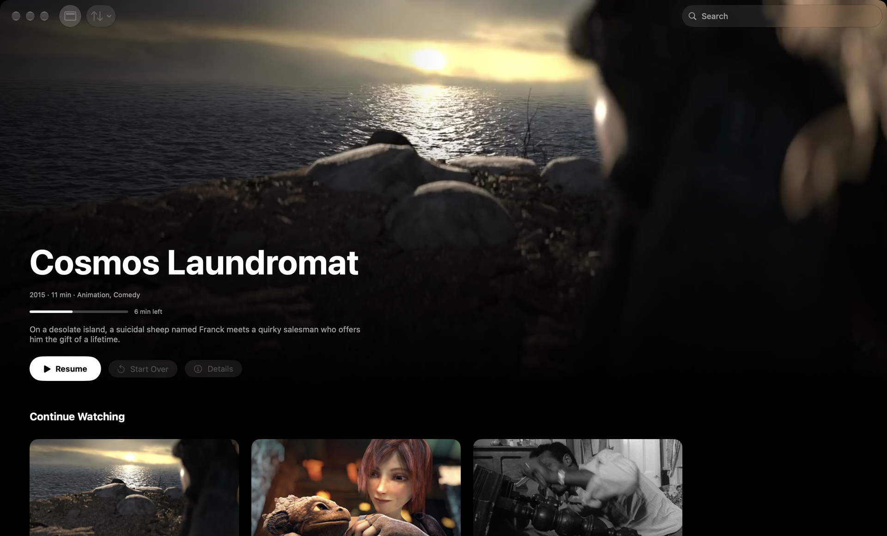
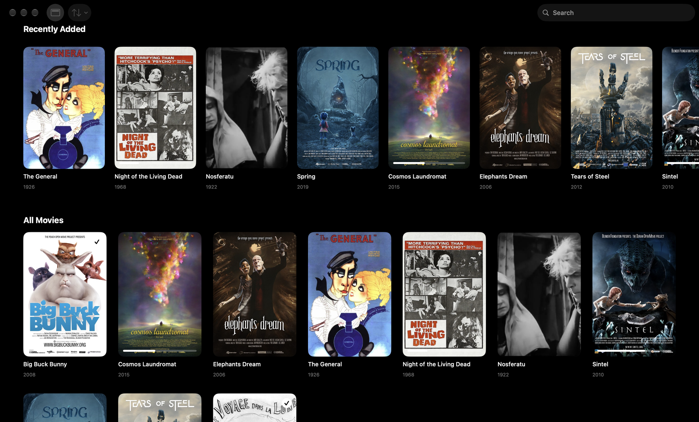
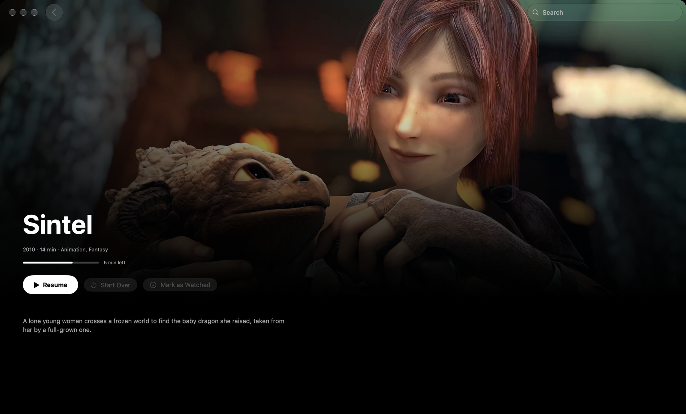
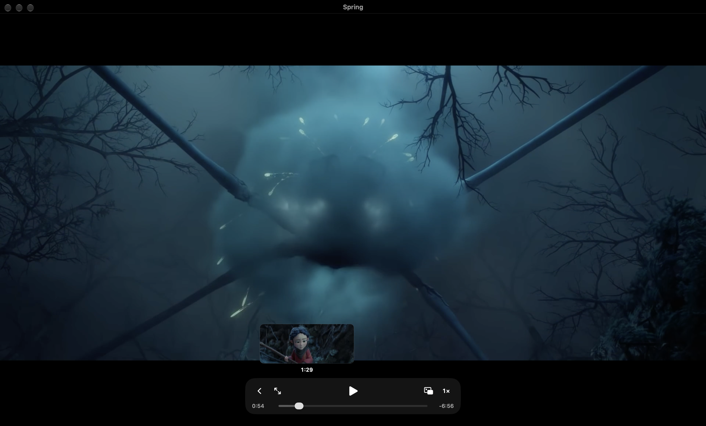

# Macfin

A native Mac app for the movies and TV shows on your Jellyfin server.

Browse your library, play a movie in a player modeled on QuickTime, and pick up where you left off
in any other Jellyfin app.



| Library | Details | Player |
|---|---|---|
|  |  |  |

## Features

- **Home**: the movie you’re watching at the top, then Continue Watching, Recently Added, and every movie in a grid.
- **TV shows**: a TV Shows row, a page per show with its seasons and episodes, Up Next for the next episode to watch,
  and a Next Episode button in the player.
- **Search and sort**: filter by title, sort by title, date added, or year.
- **Player**: a bare video surface with a small glass control bar: play/pause, 10-second skips, speed from 0.5× to 2×,
  picture in picture, and full screen. The controls hide after 2.5 seconds of playback.
- **Scrubbing preview**: hover the timeline to see a thumbnail of that moment, from Jellyfin’s trickplay images.
- **Progress sync**: Macfin reports your position every 10 seconds, on pause, and when you quit, so Swiftfin or the
  web app resume where you stopped. Mark a movie as watched or unwatched from its details page or its context menu.
- **Quick Connect**: sign in Swiftfin on your iPhone or iPad by typing its code on the Mac (Macfin › Connect a Device…, ⌘K).
- **Keychain and sandbox**: the session token is stored in your keychain, and the sandboxed app can only make outgoing network connections.
- English and French.

Keyboard: Space plays or pauses, ← and → skip 10 seconds, F toggles full screen, Esc goes back, ⌘R refreshes the library.

## Requirements

- macOS 26 or later
- A [Jellyfin](https://jellyfin.org) server (10.9 or later) with a Movies library
- To build: Xcode 26 and [XcodeGen](https://github.com/yonaskolb/XcodeGen)

## Installation

There’s no signed download yet: build Macfin from source.

```bash
brew install xcodegen
git clone <this repository> macfin && cd macfin
xcodegen generate
xcodebuild -project Macfin.xcodeproj -scheme Macfin -configuration Release -derivedDataPath build build
cp -R build/Build/Products/Release/Macfin.app /Applications/
```

Open Macfin and sign in with your Jellyfin address (for example `http://127.0.0.1:8096`), user name, and password.

### Signing with your own team

Builds are signed ad hoc by default, so no Apple developer account is needed. To sign with your team, for
example with a Developer ID certificate:

```bash
cp Config/Local.xcconfig.example Config/Local.xcconfig   # ignored by git
# set DEVELOPMENT_TEAM and CODE_SIGN_IDENTITY, then build again
```

If you distribute your own build, also change `PRODUCT_BUNDLE_IDENTIFIER` in `project.yml`
(`dev.byelior.macfin` belongs to the original author).

## Known limitations

- **Direct play only.** Macfin streams the original file and never asks Jellyfin to transcode. A movie plays when
  AVFoundation can read it: MP4 or MOV with H.264 or HEVC video. MKV, AVI, and most WebM files won’t play.
- **Movies and TV shows only.** No music or live TV.
- **No subtitle or audio track picker.** The file’s default tracks are used.
- **Plain HTTP only on the local network.** App Transport Security allows `http://` for local addresses; a remote
  server needs `https://`.
- **Not notarized.** No signed build is published yet.
- Dark appearance only, by design.

## Development

- `project.yml` is the source of the Xcode project: run `xcodegen generate` after adding or removing files.
- `DESIGN.md` describes the interface and its tokens (`Macfin/DesignSystem/Tokens.swift`).
- Strings live in `Macfin/Resources/Localizable.xcstrings`, with English as the development language.
- `scripts/demo-library.sh` builds a throwaway Jellyfin server on port 8097 with short excerpts of free movies, and
  `scripts/screenshots.sh` captures the screenshots above from a Debug build. Neither touches a Jellyfin server you
  already run on port 8096.

See [CONTRIBUTING.md](CONTRIBUTING.md) to propose a change and [SECURITY.md](SECURITY.md) to report a vulnerability.

## Credits

Macfin isn’t affiliated with the Jellyfin project. Jellyfin is free software under the GPL; Macfin only talks to its
HTTP API.

The screenshots show 2-minute excerpts (re-encoded, without sound) of the movies below, with their posters. Each
excerpt is padded with a still frame up to the movie’s real runtime, so the library shows true durations. Backdrops
are frames from the same excerpts.

| Movie | Rights | Video source | Poster |
|---|---|---|---|
| *Big Buck Bunny* (2008) | © Blender Foundation, [CC BY 3.0](https://creativecommons.org/licenses/by/3.0/) · [peach.blender.org](https://peach.blender.org) | [Internet Archive](https://archive.org/details/BigBuckBunnyFULLHD60FPS) | [Blender Foundation, CC BY 3.0](https://commons.wikimedia.org/wiki/File:Big_buck_bunny_poster_big.jpg) |
| *Sintel* (2010) | © Blender Foundation, [CC BY 3.0](https://creativecommons.org/licenses/by/3.0/) · [durian.blender.org](https://durian.blender.org) | [Internet Archive](https://archive.org/details/Sintel) | [Blender Foundation, CC BY 3.0](https://commons.wikimedia.org/wiki/File:Sintel_poster.jpg) |
| *Tears of Steel* (2012) | © Blender Foundation, [CC BY 3.0](https://creativecommons.org/licenses/by/3.0/) · [mango.blender.org](https://mango.blender.org) | [Internet Archive](https://archive.org/details/Tears-of-Steel) | [Blender Foundation, CC BY 3.0](https://commons.wikimedia.org/wiki/File:Tos-poster.png) |
| *Elephants Dream* (2006) | © Blender Foundation and Netherlands Media Art Institute, [CC BY 2.5](https://creativecommons.org/licenses/by/2.5/) | [Blender Foundation](https://download.blender.org/ED/) | [Bassam Kurdali, Andy Goralczyk, and the Blender Foundation, CC BY 4.0](https://commons.wikimedia.org/wiki/File:ElephantsDreamPoster.jpg) |
| *Cosmos Laundromat* (2015) | © Blender Institute, [CC BY 4.0](https://creativecommons.org/licenses/by/4.0/) · [gooseberry.blender.org](https://gooseberry.blender.org) | [Internet Archive](https://archive.org/details/CosmosLaundromatFirstCycle) | [Andy Goralczyk and the Blender Foundation, CC BY 4.0](https://commons.wikimedia.org/wiki/File:CosmosLaundromatPoster.jpg) |
| *Spring* (2019) | © Blender Animation Studio, [CC BY 4.0](https://creativecommons.org/licenses/by/4.0/) · [studio.blender.org](https://studio.blender.org) | [Internet Archive](https://archive.org/details/spring_blenderopenmovie) | [Francesco Siddi, CC BY 4.0](https://commons.wikimedia.org/wiki/File:Spring2019PillarPosterBlender.jpg) |
| *Nosferatu* (1922), F. W. Murnau | Public domain | [Internet Archive](https://archive.org/details/Nosferatu1922) | Frame from the film |
| *Night of the Living Dead* (1968), George A. Romero | Public domain | [Internet Archive](https://archive.org/details/Night.Of.The.Living.Dead_1080p) | [Public domain](https://commons.wikimedia.org/wiki/File:Night_Of_The_Living_Dead_(1968)_-_Poster.jpg) |
| *A Trip to the Moon* (1902), Georges Méliès | Public domain | [Internet Archive](https://archive.org/details/ATripToTheMoonGeorgeMelies) | [Public domain](https://commons.wikimedia.org/wiki/File:Voyage_dans_la_Lune_affiche.jpg) |
| *The General* (1926), Buster Keaton | Public domain | [Internet Archive](https://archive.org/details/TheGeneral1926) | [Public domain](https://commons.wikimedia.org/wiki/File:The_general_movie_poster.jpg) |

Movie summaries in the demo library were written for this project.

## License

[MIT](LICENSE)
